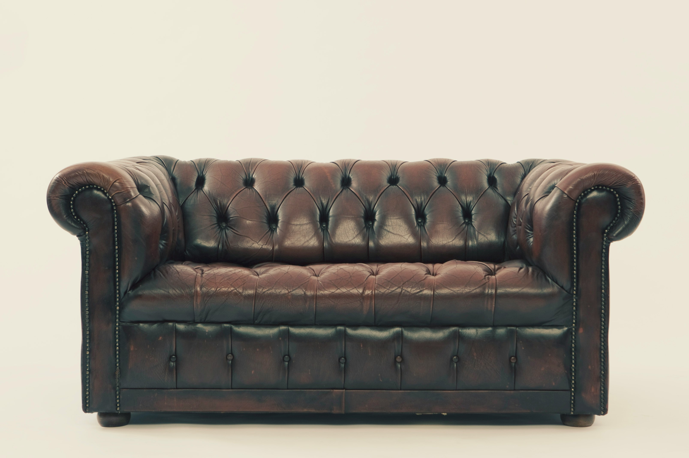
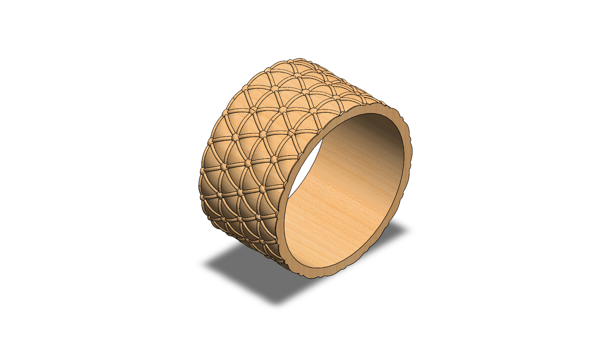
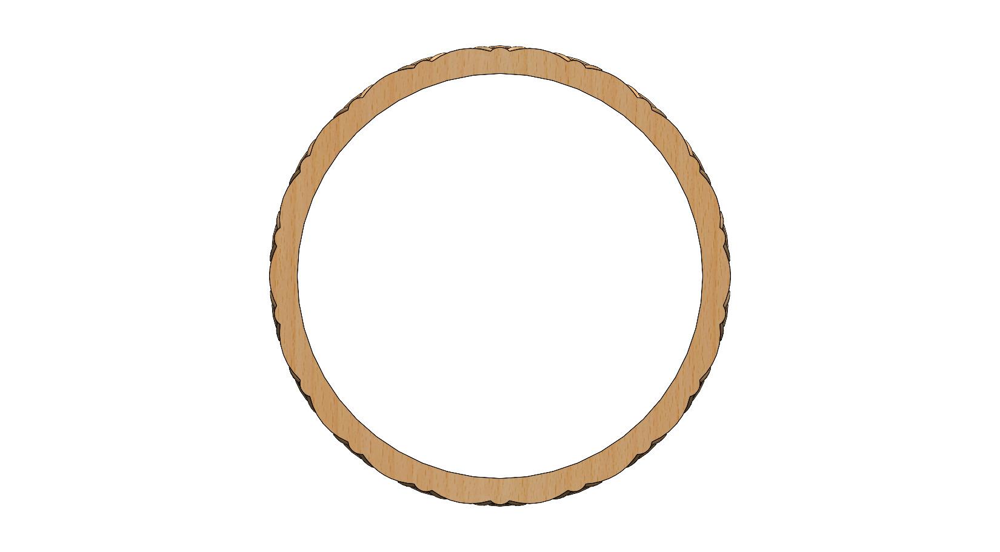
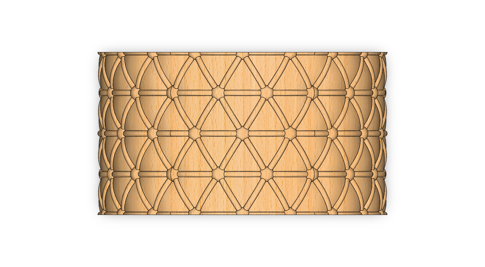
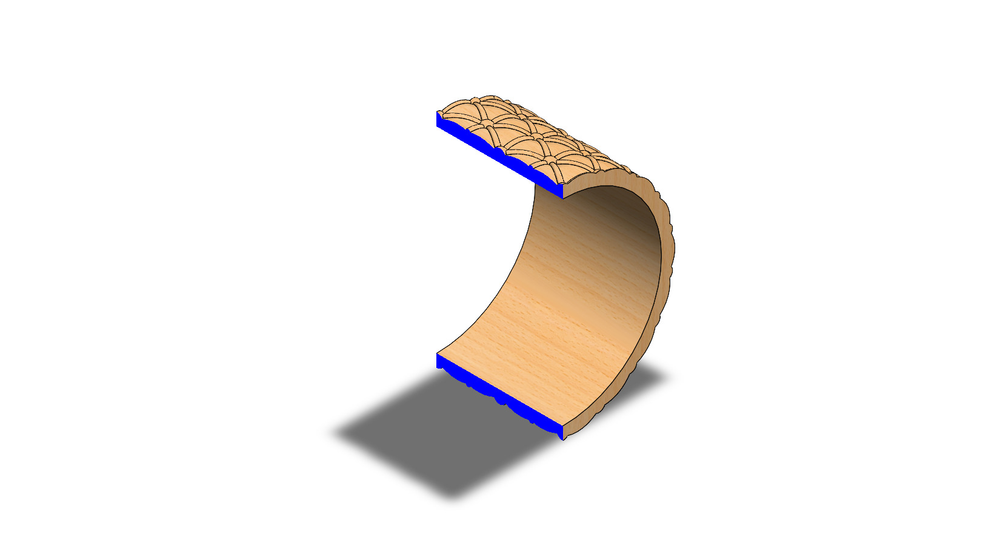

# Concept Design Prototype of a Chesterfield Art on a Ring

## Summary

This concept prototype design started with a YouTube video that inspired me to try a Chesterfield-style pattern on a ring. Later, I became fascinated by the design of the Chesterfield sofa itself [^2], especially its deep button-tufted diamond pattern and rolled forms [^1].

|         Name          |                          Image                           |
| :-------------------: | :------------------------------------------------------: |
| Chesterfield Sofa[^1] |  |

---

## Computational Design

|   View    |                        Image                         |
| :-------: | :--------------------------------------------------: |
| Isometric |  |
|   Left    |            |
|   Right   |          |
|   Back    |            |
|   Front   |          |
|    Top    |              |
|  Bottom   |        |
|  Section  |      |

---

## Technologies Used

### Software

| Purpose |               Name                |
| :-----: | :-------------------------------: |
| Design  | SolidWorks 2024 (Student Version) |

---

## Applications [^3]

- Statement and Cocktail Ring
- Fashion Ring for Everyday Wear
- Stacking Ring
- Signet-Style Ring
- Gift or Keepsake Ring
- Custom Made-to-Order Jewelry

---

## Design Limitations

The design of the Chesterfield-inspired ring was developed as a prototype product. That’s why the real-life design considerations, including ring-size standards, comfort of wear, wall thickness for casting, metal selection, scale of the tufted pattern relative to a finger-sized band, proper design specification, monetization, and feasibility, have not been included.

---

## Future Improvements

The design is a concept study that transfers the button-tufted diamond pattern of a Chesterfield sofa onto a ring. The pattern should next be parametrized so that the diamond count, button spacing, and pattern depth can be changed from a few driving dimensions, and the ring size could then be adjusted without rebuilding the model. Real jewelry also needs a metal selection (such as yellow, white, or rose gold, or silver), a check of the minimum wall thickness and the depth of the tufted recesses for casting or 3D printing in wax, and comfort testing of the inner surface. Variants such as a signet-style or stacking version could also be developed from the same pattern.

---

## References

[^1]: [Photo by Hal Gatewood](https://unsplash.com/photos/brown-leather-chesterfield-sofa-Vfml26Iy4mI)

[^2]: [What Is a Chesterfield Sofa?](https://www.chairish.com/blog/what-is-a-chesterfield-sofa)

[^3]: [10 Popular Types of Rings and Their Meanings](https://newportworldresorts.com/blog-articles/10-popular-types-rings-and-their-meanings)
