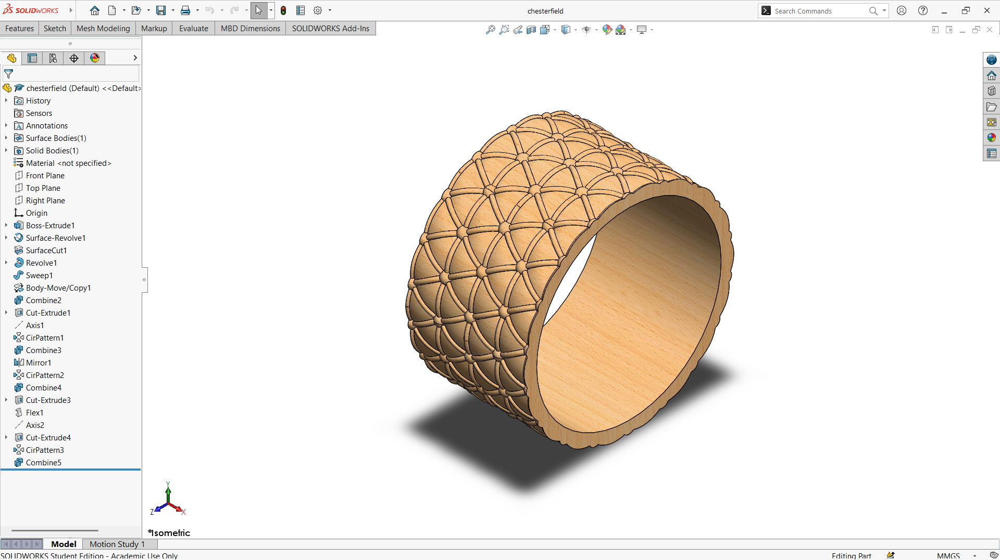

# A Chesterfield-Inspired Tufted Pattern on a Wide Ring

## Summary

This concept prototype design started with a YouTube video that inspired me to try a Chesterfield-style pattern on a ring. Later, I became fascinated by the design of the Chesterfield sofa itself [^2], especially its deep button-tufted diamond pattern and rolled forms [^1]. The Chesterfield is known as a classic piece of furniture whose tufted surface gives it a rich, recognizable character, and I wanted to see whether that character could be carried over from a large sofa onto a small piece of jewelry.

The ring is a wide band whose outer surface is covered with a repeating lattice of raised ridges. The ridges cross at rounded, button-like points, which imitates the tufting of the sofa, while the inner surface is kept smooth so that the ring remains comfortable to wear. Turning a flat upholstery pattern into a pattern that wraps around a curved band was the main challenge of the project, because the pattern has to stay evenly spaced and continuous all the way around the ring without visible breaks at the joint.

The ring was developed as a computational model in SolidWorks. The views and the section view below show how the pattern, the band thickness, and the smooth inner surface come together. This prototype is a base concept design that can be developed further into a real, wearable piece of jewelry.

|         Name          |                          Image                           |
| :-------------------: | :------------------------------------------------------: |
| Chesterfield Sofa[^1] |  |

---

## Computational Design

|   View    |                        Image                         |
| :-------: | :--------------------------------------------------: |
| Isometric |  |
|   Left    |            |
|   Right   |          |
|   Back    |            |
|   Front   |          |
|    Top    |              |
|  Bottom   |        |
|  Section  |      |

---

## Software Used

| Purpose |               Name                |
| :-----: | :-------------------------------: |
| Design  | SolidWorks 2024 (Student Version) |

---

## Feature Tree

| No  |       Name       |
| :-: | :--------------: |
| 01  |   Boss Extrude   |
| 02  | Surface Revolve  |
| 03  |   Surface Cut    |
| 04  |     Revolve      |
| 05  |      Sweep       |
| 06  |  Body Move/Copy  |
| 07  |     Combine      |
| 08  |   Cut Extrude    |
| 09  |       Axis       |
| 10  | Circular Pattern |
| 11  |      Mirror      |
| 10  |       Flex       |

---

## Feature Tree Image

---

## Applications [^3]

- Statement and Cocktail Ring
- Fashion Ring for Everyday Wear
- Stacking Ring
- Signet-Style Ring
- Gift or Keepsake Ring
- Custom Made-to-Order Jewelry

---

## Design Limitations

The design of the Chesterfield-inspired ring was developed as a prototype product. That’s why the real-life design considerations, including ring-size standards, comfort of wear, wall thickness for casting, metal selection, scale of the tufted pattern relative to a finger-sized band, proper design specification, monetization, and feasibility, have not been included.

---

## Future Improvements

The design is a concept study that transfers the button-tufted diamond pattern of a Chesterfield sofa onto a ring. The pattern should next be parametrized so that the diamond count, button spacing, and pattern depth can be changed from a few driving dimensions, and the ring size could then be adjusted without rebuilding the model. Real jewelry also needs a metal selection (such as yellow, white, or rose gold, or silver), a check of the minimum wall thickness and the depth of the tufted recesses for casting or 3D printing in wax, and comfort testing of the inner surface. Variants such as a signet-style or stacking version could also be developed from the same pattern.

---

## Acknowledgements

Special thanks to the [EasyCAD Solutions](https://www.youtube.com/@EasyCADSolutions) YouTube channel for the SolidWorks tutorials that helped in creating this design. I would also like to thank the [CAD CAM Tutorials](https://www.youtube.com/c/CADCAMTutorials) YouTube channel for its tutorials and learning resources, and [Mr. Md. Abdus Salam](https://mpe.iutoic-dhaka.edu/profile/salam/education), Drafting Instructor, Department of Mechanical and Production Engineering, Islamic University of Technology, for his guidance and support, and for his assistance in our ME 4210 3D Solid Modeling and Assembling lab course. I took assistance from [Claude](https://claude.ai), an AI assistant by [Anthropic](https://www.anthropic.com), in preparing this documentation. I provided the template, and Claude followed it and my instructions.

---

## References

[^1]: [Photo by Hal Gatewood](https://unsplash.com/photos/brown-leather-chesterfield-sofa-Vfml26Iy4mI)

[^2]: [What Is a Chesterfield Sofa?](https://www.chairish.com/blog/what-is-a-chesterfield-sofa)

[^3]: [10 Popular Types of Rings and Their Meanings](https://newportworldresorts.com/blog-articles/10-popular-types-rings-and-their-meanings)
